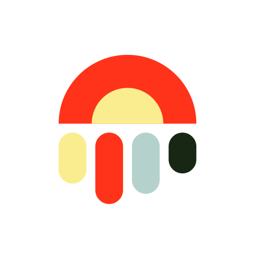
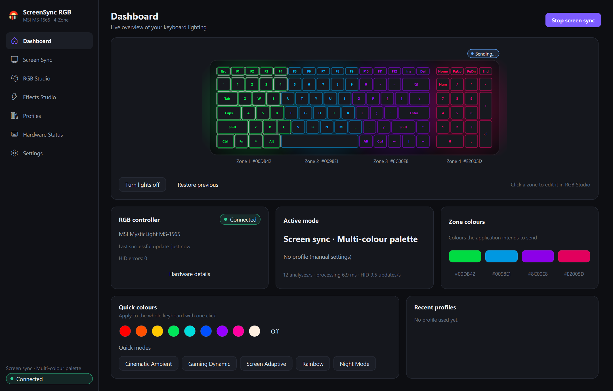
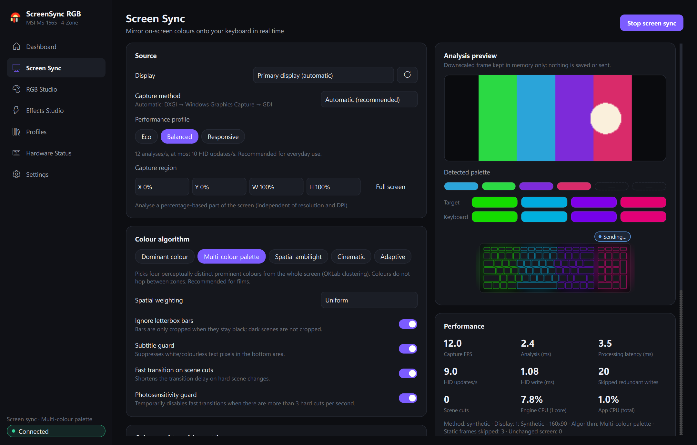
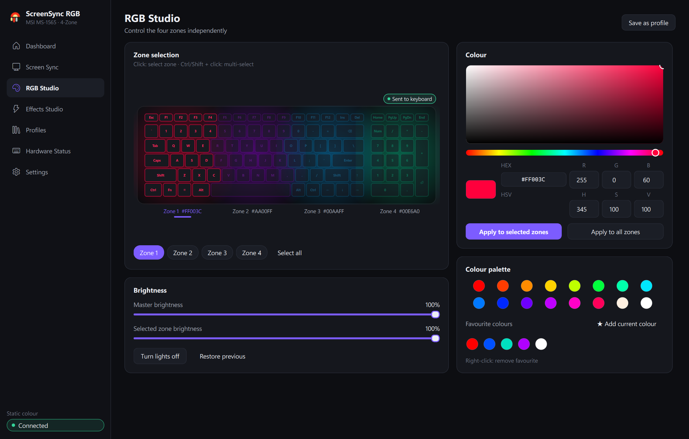
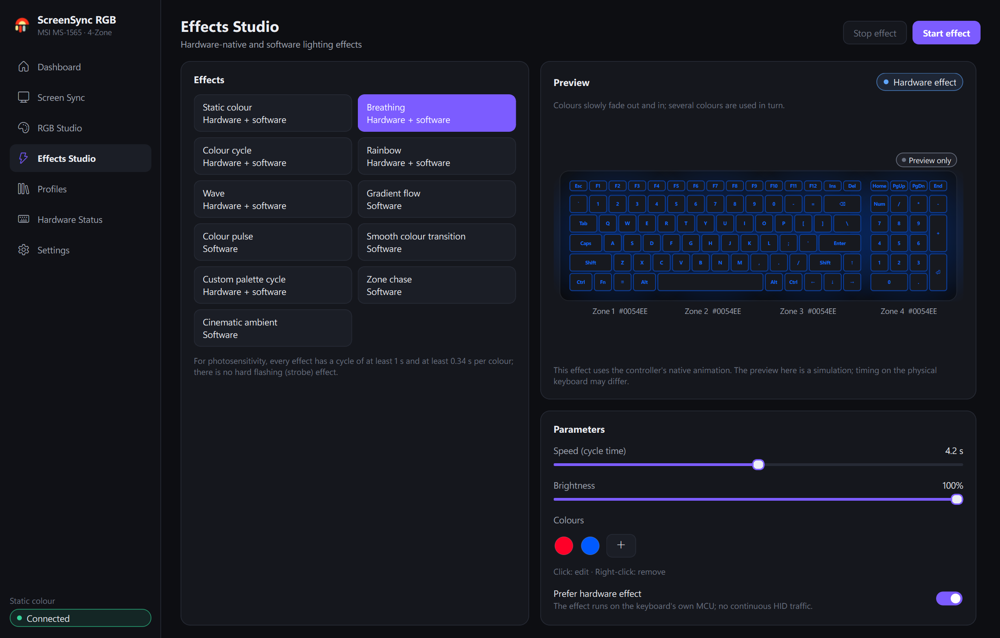
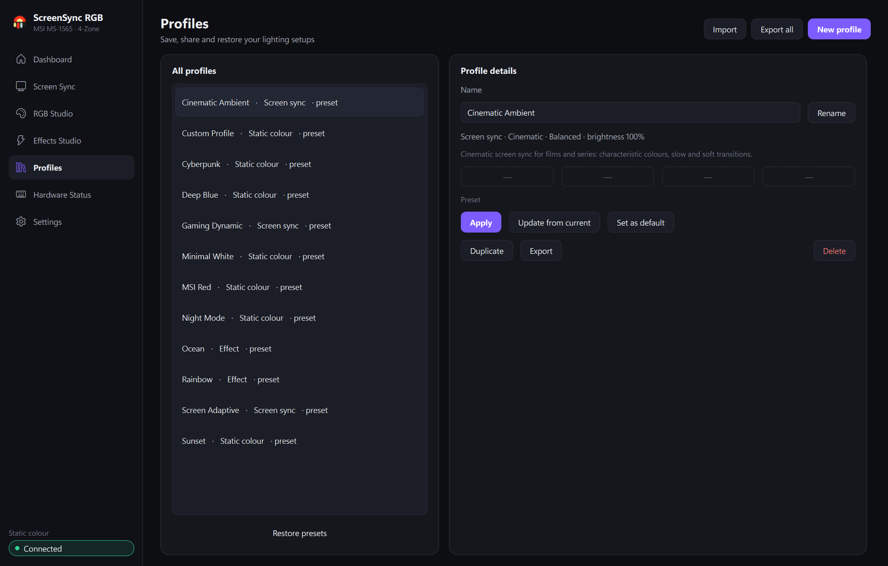
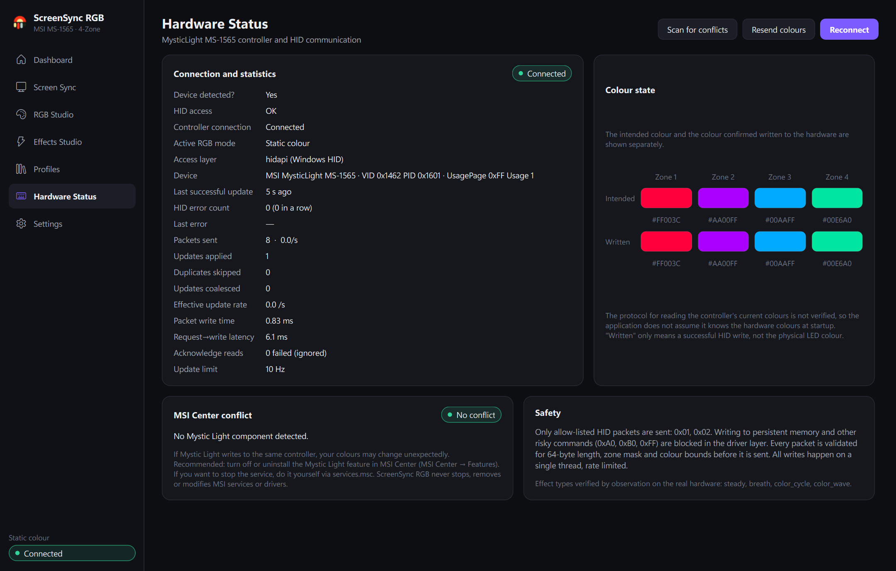
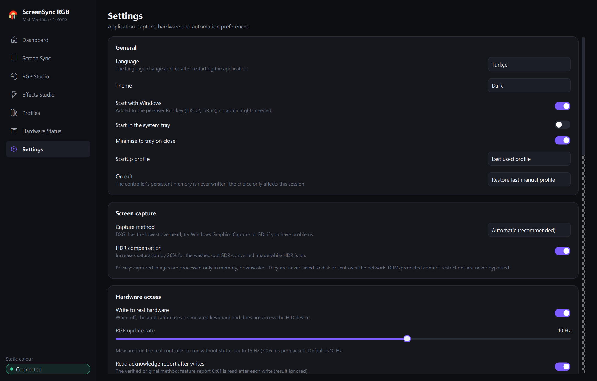

<p align="center"></p>

<h1 align="center">ScreenSync RGB</h1>

**Ambient, screen-synced lighting and full manual RGB control for the MSI Katana 15 HX 4-zone keyboard, without MSI Center.**

ScreenSync RGB watches what is on your screen (films, series, games, the desktop) and mirrors its colours onto the four lighting
zones of your keyboard in real time, with smooth, flicker-free transitions. It also works as a lightweight, independent RGB studio:
per-zone colours, native keyboard effects, profiles and automation.

[](https://github.com/Klewen/ScreenSync-RGB/releases/latest/download/ScreenSyncRGB-win64.zip)
&nbsp;
[](https://github.com/Klewen/ScreenSync-RGB/releases/latest)



<!-- Demo video (real keyboard) goes here. -->

---

## Contents

- [Supported hardware](#supported-hardware)
- [Download and install](#download-and-install)
- [Getting started](#getting-started)
- [Features](#features)
- [Screen sync modes](#screen-sync-modes)
- [Effects](#effects)
- [Safety and privacy](#safety-and-privacy)
- [MSI Center](#msi-center)
- [Troubleshooting](#troubleshooting)
- [Performance](#performance)
- [Building from source](#building-from-source)
- [License](#license)
- [Disclaimer](#disclaimer)

## Supported hardware

| | |
|---|---|
| Laptop | **MSI Katana 15 HX (B14W)** |
| Keyboard controller | MSI MysticLight **MS-1565**, 4-zone RGB (USB HID `VID 0x1462` / `PID 0x1601`) |
| OS | Windows 11, 64-bit (tested on Windows 11 Pro 25H2) |

Other MSI laptops that use the same MS-1565 controller may work, but only the Katana 15 HX B14W has been tested.
The app only ever opens that exact HID device; if it isn't present, ScreenSync RGB tells you and does nothing.

## Download and install

1. **[Download `ScreenSyncRGB-win64.zip`](https://github.com/Klewen/ScreenSync-RGB/releases/latest/download/ScreenSyncRGB-win64.zip)** (≈72 MB) from the [Releases](https://github.com/Klewen/ScreenSync-RGB/releases) page.
2. Extract the zip to a permanent folder, e.g. `C:\Program Files\ScreenSyncRGB` or `C:\Tools\ScreenSyncRGB`.
   Keep the folder together: `ScreenSyncRGB.exe` needs the `_internal` folder next to it.
3. Run **`ScreenSyncRGB.exe`**. No installer, no admin rights, no drivers.

> **Windows SmartScreen:** the executable is not code-signed, so on first launch Windows may say *"Windows protected your PC"*.
> Click **More info → Run anyway**. This is normal for unsigned hobby software. If you prefer, [build it yourself](#building-from-source).

To uninstall, turn off *Start with Windows* in Settings (if you enabled it), delete the folder, and optionally delete
`%APPDATA%\ScreenSyncRGB` (settings and profiles) and `%LOCALAPPDATA%\ScreenSyncRGB` (logs).

## Getting started

1. Open the app. The status pill in the bottom-left corner should say **Connected**.
2. **Screen sync:** click **Start screen sync** on the Dashboard. For films, try the *Multi-colour palette* or *Cinematic* algorithm; for games, *Spatial ambilight*.
3. **Manual colours:** open **RGB Studio**, click a zone on the keyboard (Ctrl/Shift + click for several) and pick a colour.
4. **Effects:** open **Effects Studio**, choose an effect and press **Start effect**.
5. Closing the window keeps the app running in the **system tray**. Right-click the tray icon to start or stop sync, switch profiles, or quit.

Interface languages: **Turkish** (default) and **English**. Switch under *Settings → General → Language* and restart the app.

## Features

| | |
|---|---|
|  | **Screen Sync**: pick a display and an algorithm, tune sensitivity, transition speed, smoothing, brightness, saturation, black level and update rate, and watch a live analysis preview with the detected palette and performance metrics. |
|  | **RGB Studio**: four independent zones, an HSV colour picker with HEX/RGB/HSV fields, master and per-zone brightness, a palette, favourite colours, lights on/off and *restore previous*. |
|  | **Effects Studio**: 11 effects with speed, brightness, direction and colours. Native effects run on the keyboard itself; the others are rendered by the app. |
|  | **Profiles**: 12 presets (Cinematic Ambient, Gaming Dynamic, Deep Blue, MSI Red, Cyberpunk, Ocean, Sunset, Rainbow, Night Mode, Minimal White, Screen Adaptive, Custom). Create, edit, duplicate, delete, import/export (JSON) and set a default. |
|  | **Hardware Status**: device detected, HID access, connection, active mode, the colours the app *intends* to send next to the colours *confirmed written*, error count, last update and an MSI Center conflict check. |
|  | **Settings**: start with Windows, start in tray, close to tray, startup profile, exit behaviour, capture method, performance profile, automation (night-mode schedule, per-app profiles, fullscreen-game detection), recovery and a log viewer. |

The keyboard preview always shows the colours the app is actually trying to send. A badge tells you whether they were written to the
keyboard, are still being sent, or could not be sent. For native effects it says the preview is a simulation, since the app never claims
to know the physical LED colour.

## Screen sync modes

| Mode | Best for | What it does |
|---|---|---|
| **Dominant colour** | calm ambient light | The single most prominent colour on all four zones. Black areas and subtitles are ignored. |
| **Multi-colour palette** | films and series | Four perceptually distinct prominent colours (e.g. red flowers, light-blue sky, cream wall, burgundy details), kept on stable zones. |
| **Spatial ambilight** | games | The screen is split into four vertical strips; each zone follows its own strip, left to right. |
| **Cinematic** | dark, moody content | Favours characteristic, saturated colours. Dark scenes stay dark, but a small strong light (a red lamp in a black scene) still shows. |
| **Adaptive** | everything | Picks one of the above per scene: dark → cinematic, single colour → dominant, left/right differ → spatial, otherwise → palette. |

Under the hood: colour analysis in the perceptual OKLab space, letterbox (black bar) detection, a subtitle guard, scene-cut detection
for instant reaction to hard cuts, zone matching so colours don't jump between zones, and time-based smooth transitions.
Capture uses DXGI Desktop Duplication, with Windows Graphics Capture and GDI as automatic fallbacks.

## Effects

| Effect | Runs on |
|---|---|
| Static colour, Breathing, Colour cycle, Rainbow, Wave, Custom palette cycle | the keyboard's own controller (no ongoing USB traffic); a software fallback is available |
| Gradient flow, Colour pulse, Smooth colour transition, Zone chase, Cinematic ambient | the app (rate-limited updates) |

There is no strobe effect. Every effect cycles in 1 s or longer and holds each colour for at least 0.34 s,
which keeps luminance changes well below the common photosensitivity guideline of 3 flashes per second.

## Safety and privacy

- **Nothing is ever written to the keyboard's permanent memory.** The controller supports a *save to flash* command (`0xA0`). ScreenSync RGB
  never sends it, and its driver layer blocks it along with every other non-allow-listed command. Only *select zones* (`0x01`) and
  *set effect* (`0x02`) are sent. Your MSI default lighting comes back after a reboot.
- Every packet is validated (length, zone mask, colour range) before it is sent. All writes come from a single thread and are rate-limited (≤ 15 updates/s), and identical updates are skipped.
- No firmware, BIOS or embedded-controller access. No driver changes, no Zadig/libusb. MSI services are never stopped or modified.
- **Screen content never leaves your PC.** Frames are downscaled to 160×90 in memory for analysis and are never saved or sent anywhere.
  DRM-protected video shows up black for every capture tool. ScreenSync RGB tells you when that happens and makes no attempt to bypass it.
- No network access, no telemetry.

## MSI Center

MSI Center / Mystic Light can drive the same controller. When ScreenSync RGB detects its lighting services, it shows a warning.
During testing they did not override ScreenSync RGB, but for the cleanest results turn off or uninstall the *Mystic Light* feature in MSI Center.
ScreenSync RGB never touches MSI Center itself.

## Troubleshooting

| Problem | Fix |
|---|---|
| *Device not found* | Make sure you are on a supported laptop. The app retries automatically (up to every 30 s). Check *Hardware Status*. |
| *Access denied* | Another program holds the device exclusively. Close MSI Center's Mystic Light and press **Reconnect** on *Hardware Status*. |
| Colours change by themselves | Mystic Light is probably writing too; disable it, or enable *Settings → Periodic resend*. |
| Screen sync shows black | DRM-protected content, the lock screen or an exclusive-fullscreen app. Try another *capture method* in Settings. |
| Keyboard doesn't follow after sleep | Wait a few seconds after waking. The app re-sends your colours once the display is back on. If it still doesn't follow, press **Resend colours** on *Hardware Status*. |
| SmartScreen blocks the app | **More info → Run anyway** (unsigned executable). |

Logs: `%LOCALAPPDATA%\ScreenSyncRGB\logs\screensync.log` (also visible under *Settings → Log*).
Command-line options: `--tray` (start hidden), `--simulate` (no hardware access), `--profile <id>`, `--quit`, `--debug`.

## Performance

Measured on the Katana 15 HX (2560×1440 @ 165 Hz) with the real keyboard, *Balanced* profile:

| | |
|---|---|
| Capture → colours ready | ≈ 8 ms per frame (capture 5.6 ms, analysis 2.1 ms) |
| Keyboard updates | ≈ 9.4 / s (limit 10), 0 HID errors |
| CPU | ≈ 0.4 % of the whole CPU in the background, ≈ 0.9 % with the window open |
| Memory | ≈ 220 MB |

On a static screen there is no analysis and no USB traffic at all. *Eco* and *Responsive* profiles are available.

## Building from source

Requirements: Windows 11 and [uv](https://docs.astral.sh/uv/) (Python 3.12 is installed by uv).

```bash
git clone https://github.com/Klewen/ScreenSync-RGB.git
cd ScreenSync-RGB
uv sync
uv run screensync-rgb
```

Run without touching the hardware:

```bash
uv run screensync-rgb --simulate
```

Tests (no hardware needed):

```bash
uv run pytest -q
```

Build the Windows executable (runs the tests first):

```bash
powershell -ExecutionPolicy Bypass -File scripts\build_exe.ps1
```

Output: `dist\ScreenSyncRGB\ScreenSyncRGB.exe` and `dist\ScreenSyncRGB-win64.zip`.

Install (or update) the build for your user under `%LOCALAPPDATA%\Programs\ScreenSyncRGB`, with Start Menu and Desktop shortcuts:

```bash
powershell -ExecutionPolicy Bypass -File scripts\install_local.ps1
```

Technical documentation (Turkish): [architecture](docs/ARCHITECTURE.md), [HID protocol](docs/HARDWARE_PROTOCOL.md),
[colour engine](docs/COLOR_ENGINE.md), [safety](docs/SAFETY.md), [testing](docs/TESTING.md),
[hardware validation](docs/HARDWARE_VALIDATION.md), [benchmarks](docs/BENCHMARKS.md), [user guide](docs/USER_GUIDE.md) ·
[README (Türkçe)](docs/README.tr.md)

## License

ScreenSync RGB is released under the [MIT License](LICENSE) © 2026 altugcakir.
The Windows release bundles third-party components under their own licenses (Qt/PySide6 under LGPLv3, OpenCV under Apache-2.0, and others).
See [THIRD-PARTY-NOTICES.md](THIRD-PARTY-NOTICES.md).

## Disclaimer

ScreenSync RGB is an independent project. It is **not affiliated with, endorsed by or supported by MSI**. *MSI*, *Mystic Light*
and *Katana* are trademarks of Micro-Star International. The app only uses non-persistent lighting commands, but you use it at your own risk.
