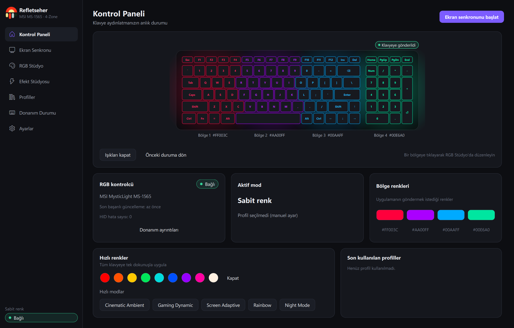

# Refletseher (Türkçe)

> English: [README](../README.md)

MSI Katana 15 HX B14W'nin 4 bölgeli klavyesi (MysticLight **MS-1565**, VID `0x1462` / PID `0x1601`) için Windows 11 masaüstü
aydınlatma stüdyosu: ekrandaki film/oyun renklerini gerçek zamanlı klavyeye yansıtır ve MSI Center'dan bağımsız manuel RGB kontrolü sağlar.

*Refletseher*, Fransızca *reflet* (yansıma) ile Türkçe *seher* (şafak vakti) sözcüklerinden oluşur: ekranın ışığının yansıması.
Uygulamanın eski adı **ScreenSync RGB**'dir.



## Özellikler

- **Ekran senkronu**: Baskın renk, Çok renkli palet, Konumsal ambilight, Sinematik, Uyarlanabilir. OKLab kümeleme, siyah alan/altyazı/letterbox
  yönetimi, sahne kesmesi algılama, bölge zıplamasını önleyen eşleme, yumuşak geçişler, ışık hassasiyeti koruması.
- **RGB Stüdyo**: 4 bağımsız bölge, HSV/RGB/HEX renk seçici, ana + bölge parlaklığı, palet, favoriler, geri al.
- **Efekt Stüdyosu**: 11 efekt; mümkün olanlar klavyenin kendi işlemcisinde (donanım efekti), diğerleri yazılımda.
- **Profiller**: 12 hazır profil, oluştur/düzenle/çoğalt/sil/içe-dışa aktar, varsayılan, son kullanılanlar.
- **Otomasyon**: gece modu saat aralığı, tam ekran oyun algılama, uygulamaya göre profil, koşul bitince geri dönüş.
- **Donanım durumu**: istenen ve yazıldığı doğrulanan renkler ayrı, HID istatistikleri, MSI Center çakışma uyarısı.
- **Sağlamlık**: tek HID iş parçacığı, hız sınırı (≤ 15 Hz), tekrar bastırma, üstel bekleme, uyku/kilit yönetimi, watchdog, tek örnek.
- **Güvenlik**: yalnızca `0x01` (bölge seçimi) ve `0x02` (efekt) gönderilir; `0xA0` flash kaydı ve diğer riskli komutlar sürücüde engellenir.
- Türkçe öncelikli arayüz (İngilizce dahil), koyu/açık tema, sistem tepsisi.

## Hızlı başlangıç

Gereksinim: Windows 11, [uv](https://docs.astral.sh/uv/) (0.12+). Python 3.12 uv tarafından yönetilir.

```bash
uv sync
```

```bash
uv run refletseher
```

Donanıma dokunmadan denemek için:

```bash
uv run refletseher --simulate
```

Windows uygulaması derlemek (testler geçmezse paketleme yapılmaz):

```bash
powershell -ExecutionPolicy Bypass -File scripts\build_exe.ps1
```

Çıktı: `dist\Refletseher\Refletseher.exe` ve `dist\Refletseher-win64.zip`. Exe imzasızdır; SmartScreen uyarısı için [kullanım kılavuzuna](USER_GUIDE.md) bakın.

## Testler ve ölçümler

```bash
uv run pytest -q
```

```bash
uv run pytest tests/hardware --run-hardware
```

```bash
uv run python scripts/benchmark.py --animate --hardware
```

157 otomatik test (donanım gerektirmez), 4 opt-in donanım testi. Ölçümler: [docs/BENCHMARKS.md](BENCHMARKS.md).
Gerçek donanım üzerinde: dengeli profilde yakalama→gönderim 8,3 ms, süreç CPU'su toplamın %0,4'ü, 0 HID hatası.

## Dokümantasyon

| Belge | İçerik |
|---|---|
| [USER_GUIDE](USER_GUIDE.md) | Kurulum, sayfalar, tepsi, sorun giderme |
| [ARCHITECTURE](ARCHITECTURE.md) | Katmanlar, iş parçacıkları, yakalama değerlendirmesi, hata kurtarma |
| [HARDWARE_PROTOCOL](HARDWARE_PROTOCOL.md) | MS-1565 HID protokolü, doğrulanmış/teorik ayrımı |
| [COLOR_ENGINE](COLOR_ENGINE.md) | Renk analizi, algoritmalar, geçişler |
| [SAFETY](SAFETY.md) | Neden 0xA0 kullanılmıyor, izin listesi, ışık hassasiyeti |
| [TESTING](TESTING.md) | Test stratejisi ve kapsam |
| [HARDWARE_VALIDATION](HARDWARE_VALIDATION.md) | Gerçek donanımda doğrulananlar ve bekleyenler |
| [BENCHMARKS](BENCHMARKS.md) | Performans ölçümleri |
| [PROGRESS](PROGRESS.md) | İlerleme günlüğü |

Refletseher MSI ile bağlantılı değildir. MSI Center'ın arayüzünü kopyalamaz ve onun bileşenlerini değiştirmez.
